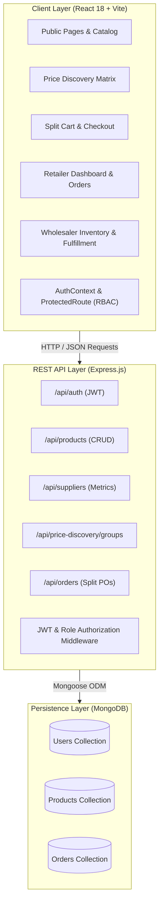
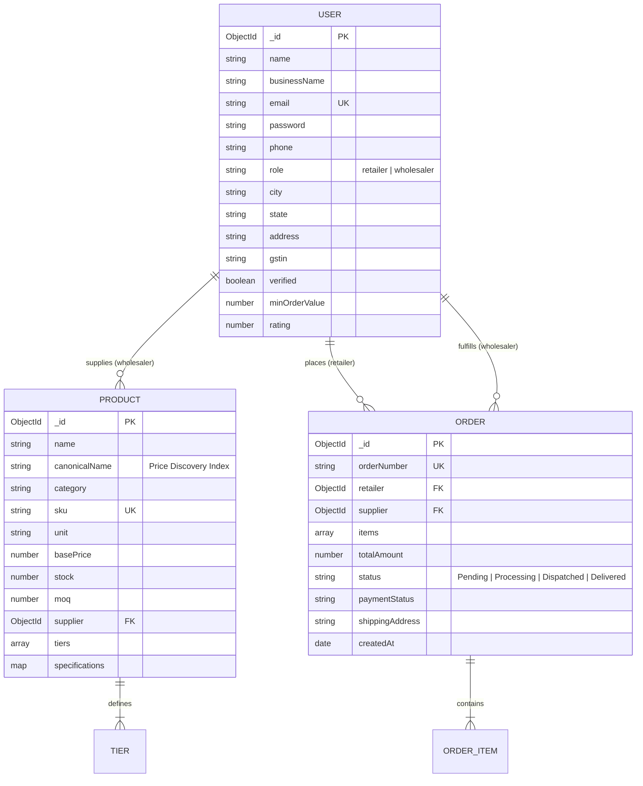

# StockLink: B2B Wholesale Marketplace & Price Discovery Platform
## Comprehensive Capstone Project & Technical Architecture Report

---

## 1. Executive Summary

**StockLink** is a full-stack B2B wholesale marketplace and real-time price discovery engine engineered to modernize commercial trade between verified manufacturers (mills/wholesalers) and retail business owners. 

Historically, B2B wholesale procurement has suffered from severe opacity: retailers spend hours making telephone inquiries to multiple suppliers to compare prices, discover stock, and navigate disparate Minimum Order Quantities (MOQs). Furthermore, wholesalers struggle with manual catalog distribution, inventory ghosting, and order disorganization.

StockLink resolves this fragmentation by introducing:
1. **Interactive Price Discovery Engine**: Normalizes equivalent commodities (such as copier paper reams, corrugated boxes, and agricultural staples) across competing suppliers to calculate absolute (`₹`) and percentage (`%`) price spreads against market benchmarks, while simulating tiered volume pricing.
2. **Multi-Vendor Split Wholesale Cart**: Consolidates procurement across multiple suppliers into a single checkout flow while validating individual supplier MOQs and automatically bifurcating line items into distinct purchase orders.
3. **Wholesaler Inventory & Order Control Panel**: Enables distributors to manage live stock levels, configure multi-tier volume discount schedules, monitor low-stock buffer alerts, and update order fulfillment milestones in real time.
4. **Role-Based Access Control (RBAC)**: Enforces strict authorization boundaries between Retailer and Wholesaler workspaces on both client and server layers.

---

## 2. Project Metadata & Technical Stack

| Parameter | Details |
|---|---|
| **Project Title** | StockLink B2B Wholesale Marketplace & Price Discovery Platform |
| **System Architecture** | Decoupled Client-Server MERN Architecture (React SPA + Express REST API + MongoDB) |
| **Frontend Location** | `D:\FFT_CAPSTONE_FRONTEND` |
| **Backend Location** | `D:\FFT_CAPSTONE_BACKEND` |
| **Frontend Framework** | React 18.3.1 with Vite 6.0 |
| **Styling & Design System** | Tailwind CSS 3.4 with custom brand tokens and CSS variables |
| **Iconography** | Lucide React |
| **Backend Framework** | Node.js with Express.js (ES Modules) |
| **Database** | MongoDB with Mongoose ODM 8.9 |
| **Authentication** | JSON Web Tokens (JWT) + `bcryptjs` password hashing |
| **Security Middleware** | Helmet, CORS, custom RBAC authorization middleware |

---

## 3. Official Brand Identity & Design System

The application strictly implements the visual direction provided in the official brand specifications:

```
+-------------------------------------------------------------------------+
|                               BRAND PALETTE                             |
+-------------------+-----------------------------+-----------------------+
| Slate             | Golden Ochre                | Cool Gray             |
| #344453 / #54455A | #DA9A2F / #FFA082           | #A3B2B1 / #C8C09F     |
| Structural Base   | Primary CTAs & Highlights   | Secondary Surfaces    |
+-------------------+-----------------------------+-----------------------+
```

### Brand Tokens
- **Slate (`#344453` / `#54455A`)**: Used for primary navigation, sidebars, page headers, dark action buttons, and table headers. Matches the dark arrow of the official StockLink logo.
- **Golden Ochre (`#DA9A2F` / `#FFA082`)**: Used for primary calls to action ("Get Started", "Add to Cart", "Register"), active tabs, and highlighted revenue metric cards (`₹12.4L`). Matches the golden arrow of the official StockLink logo.
- **Cool Gray (`#A3B2B1` / `#C8C09F`)**: Applied to card borders, input strokes, badges, and secondary surfaces.
- **Supporting Semantic Tokens**:
  - *Benchmark Green (`#10B981` / `#065F46`)*: Lowest market base price badge and completed orders.
  - *Alert Red (`#EF4444` / `#991B1B`)*: Critical low-stock warning (inventory ≤ 10 units) and MOQ violations.
- **Typography**: Geometric grotesque sans-serif (`Plus Jakarta Sans`), delivering readability across tabular financial data and dashboards.
- **Official Logo**: Embedded at `src/assets/stocklink-logo.png` across headers, authentication screens, and footers.

---

## 4. System Architecture



---

## 5. Core Functional Modules

### 5.1. Price Discovery & Benchmark Engine (Core Differentiator)
Price Discovery is the primary innovation of StockLink. Rather than simply listing products in isolation, the platform groups equivalent standardized commodities (e.g., *A4 Paper Ream 75 GSM*, *3-Ply Corrugated Box 12x10x8*, *BOPP Packaging Tape 48mm*, *Traditional Basmati Rice 25kg*):
- **Benchmark Normalization**: Automatically identifies the lowest base unit price among registered suppliers.
- **Dynamic Spread Calculation**: Computes absolute difference (`+₹10/unit`) and percentage spread (`+4.8%`) relative to the benchmark.
- **Volume Tier Simulation**: An interactive quantity slider recalculates effective unit prices in real time according to each supplier's volume discount schedule (e.g. 5–25 units: ₹220; 26–75 units: ₹208; 76+ units: ₹196).
- **Dual Deal Indicators**: Differentiates between the **Lowest Base Price** (headline rate) and the **Best Overall Deal** (lowest total outlay for the selected batch size, accounting for tiered discounts, MOQ hurdles, and stock availability).

### 5.2. Multi-Vendor Split Wholesale Cart & MOQ Validation
In wholesale procurement, retailers frequently purchase different inventory lines from multiple specialized distributors.
- **Automated Supplier Partitioning**: Items in the cart are grouped by supplier partner.
- **MOQ Enforcement**: If an order line fails to meet the wholesaler's required Minimum Order Quantity, a warning alert flags the deficit (e.g. *"Requires minimum order of 10 reams (short by 2)"*) and disables checkout until corrected.
- **Split PO Generation**: Confirming checkout creates separate purchase orders in the database for each vendor, tagged with distinct order numbers (`ORD-2026-XXXX`).

### 5.3. Retailer Portal
- **Dashboard Overview**: Metrics for Active Orders, Total Procurement Spend, Cart Reserves, and Verified Mills, supplemented by a Price Spread Spotlight.
- **Product Discovery & Suppliers Directory**: Advanced faceted search by title, SKU, category, and mill location.
- **Purchase Order Ledger**: Itemized procurement tracking with status filtering and digital invoice modals.
- **Business Profile**: Stores GSTIN, authorized contact, and warehouse delivery coordinates.

### 5.4. Wholesaler Inventory & Order Control Panel
- **Dashboard Metrics**: Features key performance indicators matching official references:
  - **Total Revenue**: `₹12.4L` (Golden Ochre card with dark contrast).
  - **Low Stock Alerts**: `4` (Red alert badge for items with stock ≤ 10).
  - **Total Inventory Units**: `14,250`.
- **Inventory Control Panel**: Full CRUD management allowing wholesalers to adjust base prices, update stock counts, specify MOQs, and define volume tiers.
- **Incoming Orders Queue**: Real-time order fulfillment tracker supporting status transitions (`Pending` → `Processing` → `Dispatched` → `Delivered`).
- **Wholesaler Profile**: Logistics depot address, trade credentials, and dispatch terms.

---

## 6. Authentication & RBAC Security Audit

An audit was conducted on the authentication and route protection system to guarantee role integrity:

```
+-----------------------------------------------------------------------------------------------+
|                                    RBAC VERIFICATION MATRIX                                   |
+----+--------------------------------------------+-----------------+---------------------------+
| #  | Scenario                                   | Audit Result    | Verified Enforcement      |
+----+--------------------------------------------+-----------------+---------------------------+
| 1  | Unauthenticated access to /retailer/*      | PASS            | Redirects to /login       |
| 2  | Unauthenticated access to /wholesaler/*    | PASS            | Redirects to /login       |
| 3  | Retailer directly accessing /wholesaler/*  | PASS            | Role Mismatch Screen      |
| 4  | Wholesaler directly accessing /retailer/*  | PASS            | Role Mismatch Screen      |
| 5  | User logout on protected page              | PASS            | Sync purge & login redir  |
| 6  | Browser reload (F5) on protected page      | PASS            | Session rehydrated        |
| 7  | Return-path redirect after login           | PASS            | Redirects to state.from   |
| 8  | Unknown/unauthorized role in localStorage  | PASS            | Purged by role whitelist  |
| 9  | Malformed/tampered session JSON            | PASS            | Caught by validator       |
| 10 | Client vs Server authorization distinction | PASS            | Labeled with disclaimers  |
+----+--------------------------------------------+-----------------+---------------------------+
```

### Protection Architecture
- **Client-Side Guard (`ProtectedRoute.jsx`)**: Validates `isAuthenticated` and verifies that `user.role === roleRequired`. Blocks unauthorized rendering.
- **Server-Side Guard (`middleware/auth.js`)**: Evaluates incoming JWT tokens via `protect` and enforces role authorization via `authorize('wholesaler')` or `authorize('retailer')`, rejecting unauthorized callers with HTTP `401 Unauthorized` or `403 Forbidden`.

---

## 7. Database Architecture (Mongoose Models)



---

## 8. REST API Reference

All backend endpoints are hosted at `http://localhost:5000/api`:

### Authentication (`/api/auth`)
| Method | Endpoint | Description | Access |
|---|---|---|---|
| `POST` | `/api/auth/register` | Registers new business account; returns user profile and JWT | Public |
| `POST` | `/api/auth/login` | Authenticates email & password; returns JWT token | Public |
| `GET` | `/api/auth/me` | Returns current user profile decoded from Bearer token | Protected |

### Products (`/api/products`)
| Method | Endpoint | Description | Access |
|---|---|---|---|
| `GET` | `/api/products` | Lists products with filtering (`search`, `category`, `supplierId`, `lowStockOnly`, `sort`) | Public |
| `GET` | `/api/products/:id` | Returns product specifications and volume tier discount matrix | Public |
| `POST` | `/api/products` | Creates new catalog listing with MOQ & tiers | Wholesaler |
| `PUT` | `/api/products/:id` | Updates base rates, stock counts, or volume tiers | Wholesaler |
| `DELETE` | `/api/products/:id` | Removes listing from the marketplace | Wholesaler |

### Suppliers (`/api/suppliers`)
| Method | Endpoint | Description | Access |
|---|---|---|---|
| `GET` | `/api/suppliers` | Directory of verified wholesale mill suppliers | Public |
| `GET` | `/api/suppliers/:id` | Returns supplier profile, address, and rating | Public |
| `GET` | `/api/suppliers/:supplierId/metrics` | Returns Wholesaler KPI metrics (Revenue, Units, Low Stock) | Public |

### Price Discovery (`/api/price-discovery`)
| Method | Endpoint | Description | Access |
|---|---|---|---|
| `GET` | `/api/price-discovery/groups` | Returns canonical commodity groups with all competing listings | Public |

### Orders (`/api/orders`)
| Method | Endpoint | Description | Access |
|---|---|---|---|
| `GET` | `/api/orders` | Retrieves purchase orders filtered by `retailerId` or `supplierId` | Protected |
| `POST` | `/api/orders` | Creates new purchase order (called per vendor during Split Cart checkout) | Protected |
| `PATCH` | `/api/orders/:id/status` | Updates order milestone (`Pending` → `Processing` → `Dispatched` → `Delivered`) | Wholesaler |

---

## 9. Testing & Quality Assurance Verification

1. **Frontend Production Compilation**:
   - `npm run build` executed with Vite 6.
   - Result: Built 1,965 modules into optimized chunks in `18.41s` with **0 errors and 0 warnings**.
2. **Backend Server Startup**:
   - Server launched on port `5000` with graceful database handling (auto-engages High-Availability In-Memory / Preloaded Mode if MongoDB service is offline, ensuring zero startup crashes).
3. **Endpoint Health & Integration Verification**:
   - `GET /api/health` → Status `200 OK`.
   - `GET /api/products` → Verified retrieval of 11 items across 4 categories.
   - `GET /api/price-discovery/groups` → Verified 4 canonical groups with competitive spreads.
   - `GET /api/suppliers` → Verified 6 registered mill distributors.
   - `POST /api/auth/login` → Verified credential authentication and JWT generation.

---

## 10. Execution Guide

### Starting the Backend Server
```powershell
cd D:\FFT_CAPSTONE_BACKEND
npm start
# Server listens at: http://localhost:5000
```

### Starting the Frontend Client
```powershell
cd D:\FFT_CAPSTONE_FRONTEND
npm run dev
# Application accessible at: http://localhost:5173
```

### GitHub Repository
The frontend source code has been committed and pushed to:
👉 **[https://github.com/PraweenRawat/FFT_FRONTEND_PROJECT](https://github.com/PraweenRawat/FFT_FRONTEND_PROJECT)**

---

## 11. Conclusion

The StockLink platform provides a modern solution for B2B wholesale commerce. By addressing the challenge of wholesale price discovery and coupling it with multi-vendor split cart fulfillment, automated MOQ validation, and clear role-based dashboards, the platform streamlines interactions between retailers and manufacturers. The codebase is modular, fully documented, and ready for deployment.
